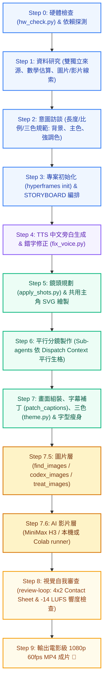

# 🎬 Motion Explainer Suite (Video + Images) — AI 原理解說動畫進階技能套件

> 專為 **Google Antigravity**、**Claude Code**、**Cursor** 與 **Codex / ChatGPT App** 打造的原理解說動畫全流程進階 AI Agent 技能套件。  
> 整合 **HyperFrames**（HeyGen 開源，HTML + GSAP）、中文高品質旁白合成、發音錯字修正、Wikimedia 授權照片證據卡、Codex 生成示意圖，以及 **MiniMax H3 / 雲端 Colab AI 視訊生成鏡頭層**，並由動態品味硬規則與 4×2 Contact Sheet 視覺審查嚴格把關，一鍵產出可以直接上課投影或上傳 YouTube 的照片級／電影級 1080p 60fps 原理解說動畫！

[](https://github.com/JeffreyHo0520/motion-explainer-video)
[](https://github.com/JeffreyHo0520/motion-explainer-video)
[](https://github.com/JeffreyHo0520/motion-explainer-video)
[](https://github.com/heygen-oss/hyperframes)
[](https://greensock.com/gsap/)
[](https://www.python.org/)
[](LICENSE)

---

## 📦 包含的核心技能組合 (Included Skills)

本儲存庫整合了完整且獨立的四大技能模組，無論在任何電腦上安裝，均能開箱即用、無缺漏依賴：

| 斜線指令 (Slash Command) | 技能目錄 | 定位與核心功能 |
| :--- | :--- | :--- |
| **`/motion-explainer-video`** | [`skills/motion-explainer-video`](skills/motion-explainer-video/SKILL.md) | **旗艦級影片加強版**：動畫講原理＋照片當證據＋AI 影片帶情緒。具備完整的「研究 → 需求訪談 → 分鏡腳本 → TTS 旁白 → **錯字修復 (`fix_voice.py`)** → 平行分鏡製作 → 字幕補丁 → 三色套用 → **圖片層 (`place_media.py`)** → **AI 影片層 (MiniMax H3 / Colab)** → 自我審查 → MP4 輸出」。 |
| **`/motion-explainer-images`** | [`skills/motion-explainer-images`](skills/motion-explainer-images/SKILL.md) | **圖文加強版**：動畫講原理＋照片當證據。以 Wikimedia Commons 免費授權照片（PD / CC0 / CC BY / CC BY-SA）作為歷史先例與真實世界佐證卡片，搭配 Codex 生成無品牌示意插圖，雙色調（Duo-tone）完美融入三色主題。 |
| **`/motion-design`** | [`skills/motion-design`](skills/motion-design/SKILL.md) | **動態品味與動畫硬規則**：規範 GSAP 確定性渲染規則（禁止無種子隨機）、階層式緩動曲線、動態節奏、閱讀停留時間與繁體中文排版標竿。 |
| **`/review-loop`** | [`skills/review-loop`](skills/review-loop/SKILL.md) | **視覺自我審查品質守門員**：透過 `scripts/sheet.py` 自動在每個旁白子句截取畫面並拼合為 4×2 Contact Sheet 聯絡表，進行對比度、疊字、留白、−14 LUFS 廣播級響度全面驗收。 |

---

## ⚡ 三大版本功能完整對比表

| 功能特性 | 基礎版 (`/motion-explainer`) | 圖片加強版 (`/motion-explainer-images`) | 影片加強版 (`/motion-explainer-video`) |
| :--- | :---: | :---: | :---: |
| **全自動管線 (研究、腳本、分鏡)** | ✅ | ✅ | ✅ |
| **Edge-TTS / Breeze TTS 2 中文語音** | ✅ | ✅ | ✅ |
| **智慧斷句與字幕時間軸對齊** | ✅ | ✅ | ✅ |
| **三色主題系統 (`theme.json`)** | ✅ | ✅ | ✅ |
| **源石黑體中文字型極致瘦身 (小 98%)** | ✅ | ✅ | ✅ |
| **4×2 Contact Sheet 視覺自我審查** | ✅ | ✅ | ✅ |
| **Wikimedia Commons 授權照片卡片** | ❌ | ✅ | ✅ |
| **AI 示意圖／概念氛圍底圖** | ❌ | ✅ | ✅ |
| **語音錯字／破音字修復 (`fix_voice.py`)** | ❌ | ❌ | ✅ |
| **MiniMax H3 AI 視訊鏡頭生成層** | ❌ | ❌ | ✅ |
| **Google Colab 雲端高階 GPU 算力調度** | ❌ | ❌ | ✅ |

---

## 🚀 完整執行架構 (Workflow Pipeline)



---

## 💻 另一台電腦快速安裝指南 (Installation on Another Computer)

本技能支援在任何安裝有 **Antigravity**、**Claude Code**、**Cursor** 或 **Codex** 的電腦上一鍵部署。

### 方式一：Windows PowerShell 一鍵聯網安裝（最推薦 ⚡）

在目標電腦打開 **PowerShell**，複製並執行以下指令，即可從 GitHub 下載並將 4 大技能全數部署到全域目錄：

```powershell
irm https://raw.githubusercontent.com/JeffreyHo0520/motion-explainer-video/main/install.ps1 | iex
```

> **提示**：若目標電腦需要覆寫舊版技能，可加上 `-Force`：
> ```powershell
> & ([scriptblock]::Create((irm https://raw.githubusercontent.com/JeffreyHo0520/motion-explainer-video/main/install.ps1))) -Force
> ```

---

### 方式二：macOS / Linux 終端機一鍵聯網安裝

在 macOS 或 Linux 終端機執行：

```bash
curl -fsSL https://raw.githubusercontent.com/JeffreyHo0520/motion-explainer-video/main/install.sh | bash
```

---

### 方式三：Git Clone 本機安裝

若希望保留原始碼並可透過 `git pull` 隨時獲得最新功能：

```powershell
# 1. Clone 儲存庫
git clone https://github.com/JeffreyHo0520/motion-explainer-video.git

# 2. 進入目錄並執行安裝
cd motion-explainer-video
.\install.ps1
```

macOS / Linux：
```bash
cd motion-explainer-video
chmod +x install.sh
./install.sh
```

---

### 方式四：手動複製安裝

將 `skills/` 目錄底下的四個資料夾複製到對應的 AI Agent 技能目錄：

| 平台 / Agent 工具 | 目標目錄 (Skills Directory) |
| :--- | :--- |
| **Google Antigravity** | `~/.gemini/config/skills/` |
| **Claude Code** | `~/.claude/skills/` |
| **OpenAI Codex / ChatGPT App** | `~/.codex/skills/` 或 `~/.agents/skills/` |
| **特定專案工作區 (Workspace)** | `./.agents/skills/` 或 `./.gemini/skills/` |

---

## 🌐 讓其他 AI Agent 直接線上讀取技能 (Direct URLs for AI Agents)

若另一台電腦的 AI Agent 具備聯網或讀取網址功能，可直接提供以下 GitHub 原始檔連結給 Agent 讀取：

- **影片加強版技能規格**：  
  `https://raw.githubusercontent.com/JeffreyHo0520/motion-explainer-video/main/skills/motion-explainer-video/SKILL.md`
- **圖片加強版技能規格**：  
  `https://raw.githubusercontent.com/JeffreyHo0520/motion-explainer-video/main/skills/motion-explainer-images/SKILL.md`
- **動態品味規範**：  
  `https://raw.githubusercontent.com/JeffreyHo0520/motion-explainer-video/main/skills/motion-design/SKILL.md`
- **自我審查規範**：  
  `https://raw.githubusercontent.com/JeffreyHo0520/motion-explainer-video/main/skills/review-loop/SKILL.md`

---

## 🎯 使用範例 (How to Use)

### 範例一：使用 `/motion-explainer-video`（AI 影片＋圖片＋解說動畫）

向您的 AI Agent 說：

```text
上網查資料，做一支 90 秒、解說「為什麼韋伯太空望遠鏡要飛到拉格朗日 L2 點」的動畫，給高中生上課用。
請加入真實 NASA 歷史照片佐證，並在開場與結尾生成 MiniMax H3 宇宙星空深空動態影片搭配講解。
```

Agent 將自動執行：
1. 查證 L2 點重力平衡物理算式與 NASA 官方資料。
2. 訪談並確立三色主題（預設黑底 `#121212`、米白字 `#F2F0EA`、橘色強調 `#FF7A1A`、源石黑體粗體）。
3. 產生繁體中文自然語音旁白，並自動校正專有名詞發音。
4. 平行繪製向量動畫，置入真實照片證據卡與 AI 影片鏡頭。
5. 進行 4×2 Contact Sheet 聯絡表自我審查，確認無誤後輸出 1080p MP4。

---

### 範例二：使用 `/motion-explainer-images`（授權照片＋AI 插圖＋解說動畫）

向您的 AI Agent 說：

```text
上網查資料，做一支 60 秒解說「飛機機翼如何產生升力」的科普動畫。
需要有真實風洞實驗照片作為佐證，並用示意插圖呈現氣流壓力差。
```

---

## 🛠️ 環境與前置需求 (Prerequisites)

- **Node.js**：22+ (`winget install OpenJS.NodeJS.LTS`)
- **Python**：3.10+ (`winget install Python.Python.3.11`)
- **ffmpeg / ffprobe**：影片編碼必備 (`winget install Gyan.FFmpeg`)
- **HyperFrames CLI**：
  ```bash
  npm install -g hyperframes
  hyperframes doctor
  hyperframes skills update faceless-explainer
  ```
- **Python 依賴庫**：
  ```bash
  pip install edge-tts pillow fonttools brotli requests
  ```
- **字型下載（開源 OFL 授權）**：
  專案建立後，執行以下任一指令即可自動下載源石黑體粗體與排版字型：
  ```powershell
  # Windows PowerShell
  powershell -ExecutionPolicy Bypass -File skills/motion-explainer-video/scripts/fetch_fonts.ps1 <專案資料夾>
  ```
  ```bash
  # macOS / Linux Bash
  bash skills/motion-explainer-video/scripts/fetch_fonts.sh <專案資料夾>
  ```

---

## 📄 授權條款 (License)

- 本專案採用 **[MIT License](LICENSE)** 開源授權。
- 第三方工具與授權聲明請參閱 **[NOTICE.md](NOTICE.md)**。
- 專案中所引用的開放字型（源石黑體、Noto 字型）遵守 **SIL Open Font License 1.1**。
- 透過技能檢索下載之照片遵守其原始創作者之 **CC / Public Domain** 授權條款。
